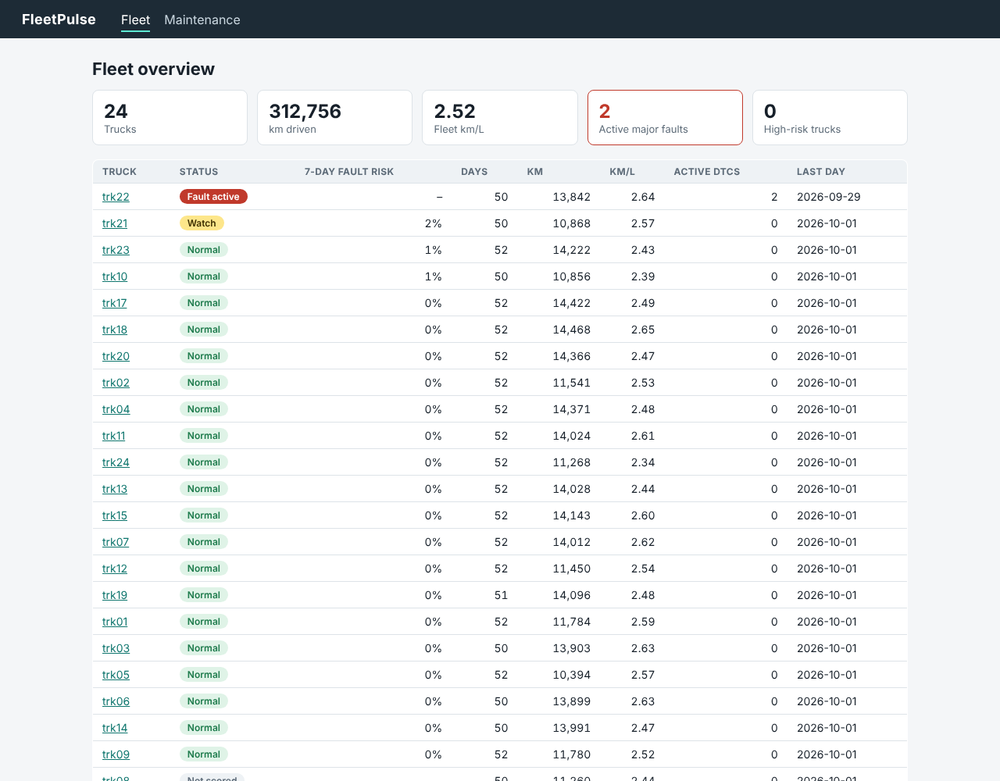
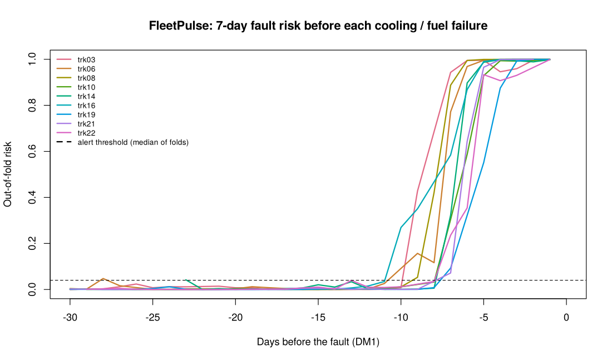
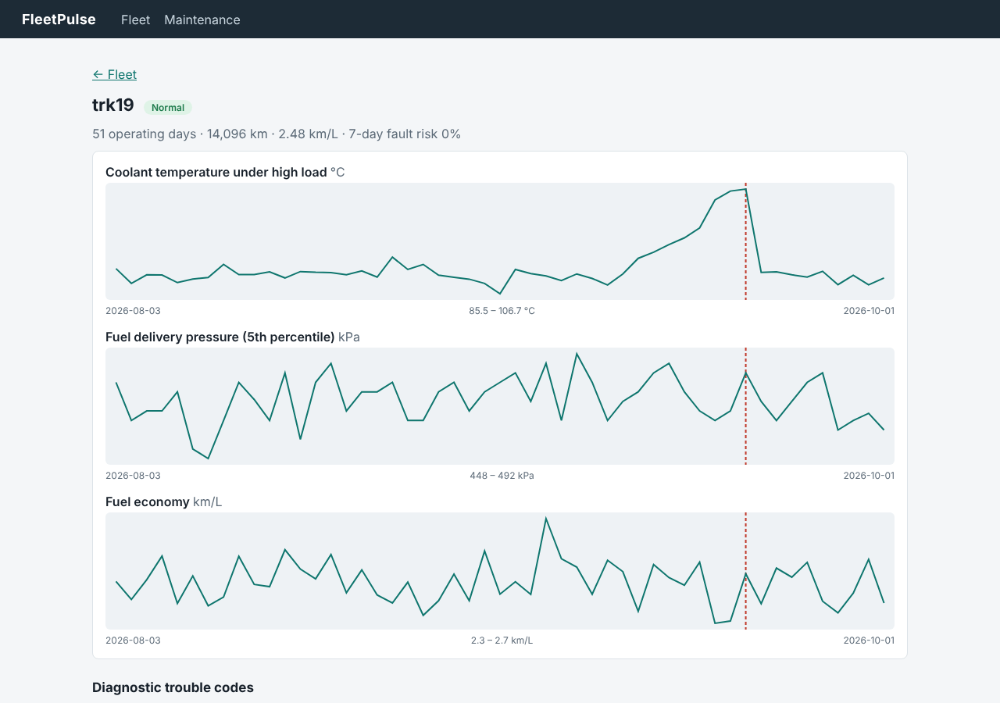
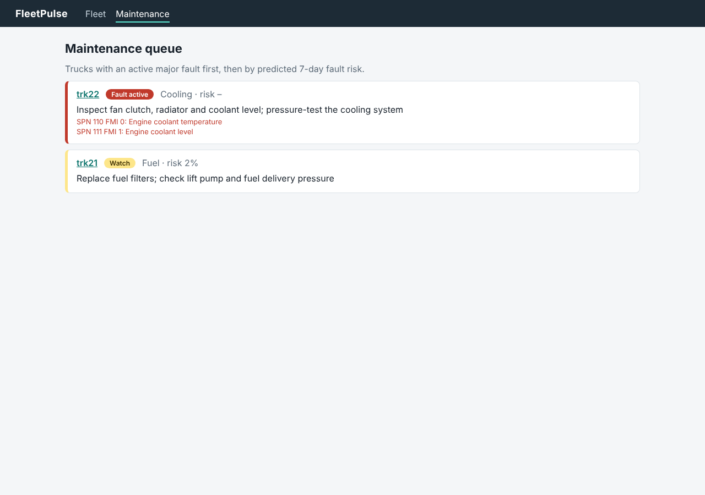

# FleetPulse — Truck Telematics & Predictive Maintenance

FleetPulse reads raw **SAE J1939 CAN bus logs** from heavy trucks, turns them into
daily health summaries and predicts which trucks will have a **cooling or
fuel-system fault in the next 7 days**, so the workshop can fix them before they
break down on the road.

| Layer | Technology | What it does |
|---|---|---|
| Decoder | **C11** (CMake) | Parses candump logs, decodes J1939 signals and DM1 trouble codes, reassembles multi-packet (BAM) messages |
| API | **.NET 8 / C#** (ASP.NET Core) | Calls the C library through **P/Invoke**, aggregates daily summaries, tracks trouble codes, serves REST |
| Analytics | **R** | Fleet- and history-relative features, regularised logistic regression, truck-grouped cross-validation |
| Dashboard | **Angular 18** (TypeScript) | Fleet overview, per-truck trends and trouble codes, maintenance queue |
| Simulator | Python | Seeded 24-truck, 60-day fleet with injected faults and decoys |



## Results (simulated fleet: 24 trucks × 60 days, 2.6 M CAN frames)

| Measure | Result |
|---|---|
| C decoder throughput | **5.7 M frames/s** on one core (output disabled) |
| Frames ingested end to end through the API | 2,602,996 from 1,231 truck-day logs in ~19 s (90 malformed lines skipped, 1,168 BAM messages reassembled, 0 transport errors) |
| Faults flagged before they happened | **9 of 9**, median **6 days** of warning (minimum 5) |
| False alert episodes | 1 in 1,038 scored truck-days (0.96 per 1,000) |
| Out-of-fold ROC AUC (4 folds grouped by truck) | 0.999 |

The fleet includes decoys that are *not* faults: a truck on a hilly route, a
truck whose payload steps up mid-period, a noisy sensor, a fleet-wide heatwave
and an unrelated battery trouble code. Features are relative to the fleet that
day and to the truck's own history, so none of them raises an alert.



All numbers come from simulated data; see [Limitations](docs/DESIGN.md#limitations).
Full report: [docs/results/report.md](docs/results/report.md).

## Run it

Needs cmake and a C compiler, Python 3, the .NET 8 SDK, R (with `jsonlite`;
`testthat` for the tests), Node 20 and curl.

```bash
./run_pipeline.sh --keep        # simulate → decode → ingest → model → maintenance queue
cd dashboard && npm ci && npm start   # http://localhost:4200
```

Step by step:

```bash
cmake -S decoder -B decoder/build && cmake --build decoder/build      # libj1939 + j1939dec + tests
python3 simulator/fleetsim.py --out data --trucks 24 --days 60 --seed 42
./decoder/build/j1939dec data/logs/trk14/2026-09-02.log | head        # CSV of decoded events
dotnet run --project api/FleetPulse.Api                                # API on http://localhost:5080
tools/ingest_logs.sh data
curl localhost:5080/api/export/daily-features.csv > analytics/out/daily_features.csv
Rscript analytics/run_analytics.R analytics/out/daily_features.csv analytics/out http://localhost:5080
```

On Windows, build the decoder with Visual Studio's CMake (it produces
`decoder/build/Release/j1939.dll`, which the API project copies next to its
binaries), or set `FLEETPULSE_J1939_LIB` to the library's full path.

## Tests

| Stack | Command | Tests |
|---|---|---|
| C | `ctest --test-dir decoder/build` (also run under ASan + UBSan) | 18 tests, 91 checks |
| .NET | `dotnet run --project api/FleetPulse.Api.Tests` | 21 (14 unit, 7 HTTP integration through the C library) |
| R | `cd analytics/tests && Rscript testthat.R` | 10 tests, 31 expectations |
| Angular | `cd dashboard && npx ng test --watch=false --browsers=ChromeHeadlessCI` | 15 |
| Simulator | `python -m pytest simulator/tests` | 4 |
| Throughput | `tools/check_bench.sh data` | ≥ 1 M frames/s |

GitHub Actions runs every stack on each push ([ci.yml](.github/workflows/ci.yml)).

## SDLC

- **Requirements:** [docs/REQUIREMENTS.md](docs/REQUIREMENTS.md) — 16 functional and 4 non-functional requirements with IDs.
- **Traceability:** each test names the requirements it checks (`REQ: FR-06`); `python tools/trace.py` fails CI if any requirement is untested ([matrix](docs/TRACEABILITY.md)).
- **Design:** [docs/DESIGN.md](docs/DESIGN.md) — data flow, decisions and trade-offs, API, limitations.
- **Backlog:** [docs/BACKLOG.md](docs/BACKLOG.md) — user stories mapped to requirements, and what comes next.
- **Quality gates:** C with `-Wall -Wextra -Wconversion -Werror` and sanitizers; .NET with warnings as errors; Angular strict TypeScript.

## Screens

| Truck detail | Maintenance queue |
|---|---|
|  |  |

## Layout

```
decoder/     C11 J1939 library, CLI and tests
api/         .NET 8 API (FleetPulse.Api) and test runner (FleetPulse.Api.Tests)
analytics/   R features, model, report, testthat tests
dashboard/   Angular 18 app
simulator/   fleet simulator and tests
tools/       ingest, throughput check, traceability, static server for the built dashboard
docs/        requirements, design, backlog, traceability, results, screenshots
```

## J1939 coverage

PGNs: EEC1 (61444), CCVS (65265), ET1 (65262), LFE (65266), EFL/P1 (65263),
DM1 (65226), TP.CM (60416, BAM) and TP.DT (60160). SPNs: 84, 94, 100, 110,
111 (DTC), 168 (DTC), 183, 184, 190.

## License

MIT
