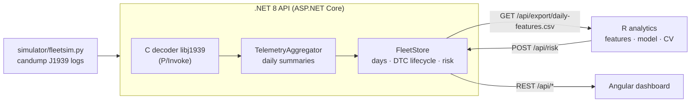

# FleetPulse design

## Data flow

## Components

**C decoder (`decoder/`)** — C11 library and CLI. Parses candump lines, splits
29-bit identifiers into priority / PGN / source address (PDU1 vs PDU2), decodes
seven SPNs with J1939-71 resolution and offset, decodes DM1 trouble codes
(J1939-73) and reassembles BAM transport-protocol messages (J1939-21). State
lives in an opaque `j1939_session` so several logs can be decoded in parallel.
The event record is a flat 48-byte struct so .NET can pass a pinned array
straight to C with no marshalling cost.

**.NET API (`api/`)** — ASP.NET Core minimal API on .NET 8 with no NuGet
dependencies. `J1939Decoder` wraps the C session and frees it on `Dispose`;
`TelemetryAggregator` is pure C# and unit-tested without the native library;
`FleetStore` is an in-memory, lock-protected store. Errors are returned as RFC
9457 problem details.

**R analytics (`analytics/`)** — base R plus `jsonlite`. Features are made
relative to the fleet that day and to the truck's own history, then a
regularised logistic regression is fitted with `optim`. Evaluation uses
cross-validation grouped by truck.

**Angular dashboard (`dashboard/`)** — Angular 18 standalone components,
signals, the new control flow syntax and a small hand-written SVG chart (no
chart library).

## Key decisions

| Decision | Why | Trade-off |
|---|---|---|
| Decode in C, call it from .NET with P/Invoke | Decoding is the hot path (5M+ frames/s on one core); the same library serves the CLI, the API and any embedded/edge use | Native build step; library must be built per OS |
| Blittable event struct, pinned buffers | No per-call marshalling of strings or arrays | Struct layout must match on both sides (checked by a test: `sizeof == 48`) |
| One HTTP request per truck-day log | Matches how telematics units upload; re-sending a day is idempotent | Many small requests; a batch endpoint would cut overhead |
| Features relative to fleet and to own history | Removes weather, route and payload effects so a drift means a fault | A truck needs about a week of history (or post-repair history) before it is scored |
| Grouped cross-validation by truck | Days from one truck are correlated; mixing them across folds would inflate scores | Few failures per fold (9 failing trucks over 4 folds) |
| Alert after 2 days in a row above threshold | Cut false alerts from 7 episodes to 0–1 at the cost of about 1 day of warning | Slightly later warnings |
| In-memory store | Keeps the prototype dependency-free | Data is lost on restart; a database is the next step |

## API

| Method | Path | Purpose |
|---|---|---|
| GET | `/api/health` | Status and decoder version |
| POST | `/api/ingest` | Body: candump log (`text/plain`). Returns decode statistics |
| GET | `/api/fleet/kpis` | Fleet totals, active faults, high-risk count |
| GET | `/api/vehicles` | One row per truck with band and risk |
| GET | `/api/vehicles/{id}` | Daily summaries and trouble codes for one truck |
| GET | `/api/faults?active=` | Trouble codes with descriptions |
| GET | `/api/export/daily-features.csv` | Feature export for the analytics |
| POST | `/api/risk` | Risk batch from the model (validated) |
| GET | `/api/maintenance` | Ranked maintenance queue |

## Limitations

- The data is simulated. The decoder follows the J1939 standards, but it has
  not been run against logs from a real truck.
- Only a subset of SPNs is decoded, and only BAM is supported (no RTS/CTS
  connection-mode transfers, which are point-to-point).
- The store is in memory and the API has no authentication.
- The model has 5 features and 9 fault examples. Its numbers show the method
  works on this data; they are not a claim about real fleets.
